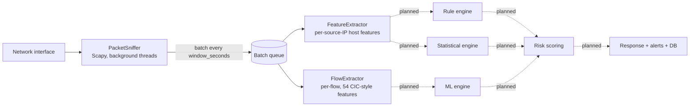

# RealGuard

**A real-time network traffic monitor and intrusion-detection pipeline for a Security Operations Center (SOC) platform.**

RealGuard sniffs live IP traffic, groups it into fixed time windows, and turns raw packets into the numerical features that detection engines need: per-device behaviour features for rule and statistical detection, and per-connection flow features compatible with the CIC-IDS2017 dataset for machine-learning models.

> **Project status: early development.** The capture and feature-extraction layers are implemented and runnable. The detection engines, risk scoring, response, and persistence layers are designed and configured (see [`settings.yaml`](realguard/config/settings.yaml)) but not yet implemented. See [Roadmap](#roadmap).

---

## Table of contents

- [Features](#features)
- [How it works](#how-it-works)
- [Project structure](#project-structure)
- [Getting started](#getting-started)
- [Configuration](#configuration)
- [Output and feature reference](#output-and-feature-reference)
- [Module self-tests](#module-self-tests)
- [Design decisions and known limitations](#design-decisions-and-known-limitations)
- [Troubleshooting](#troubleshooting)
- [Roadmap](#roadmap)
- [Security and ethical use](#security-and-ethical-use)
- [Team](#team)

---

## Features

- **Live packet capture** with [Scapy](https://scapy.net/) on a configurable interface and BPF filter, collected on a background thread so capture never blocks processing.
- **Windowed batching**: packets are flushed into a queue every `window_seconds` (default 5 s), so downstream code always works on a bounded batch.
- **Two feature views from the same packets**
  - **Host features**: one row per source IP per window (packet rate, byte rate, port/IP fan-out, protocol mix, failed-connection proxy, burst score).
  - **Flow features**: one row per bidirectional connection per window, with **54 CICFlowMeter-style features** matching the CIC-IDS2017 naming, so a model trained on that dataset can later be applied to live traffic.
- **Single central config** (`settings.yaml`): thresholds, model settings, scoring weights, and response behaviour live in one file instead of being hardcoded in engine code.
- **Centralised logging** to console and file with a consistent format, intended as an audit trail for a security product.
- **Console output** of per-device summaries and the busiest flows in each window, useful for sanity-checking the pipeline before detection is wired in.

## How it works



Solid arrows are implemented today; dotted arrows are planned.

1. **`PacketSniffer`** starts two daemon threads: one runs `scapy.sniff(...)` and converts every packet into a plain dict (timestamp, IPs, ports, protocol, TCP flags, header and payload length, TCP window); the other wakes every `window_seconds` and pushes the accumulated list onto a queue as one batch.
2. **`FeatureExtractor`** groups the batch by source IP and computes one host-level feature vector per device.
3. **`FlowExtractor`** groups the same batch by 5-tuple (both directions combined) and computes 54 flow features per connection. The direction of the first packet seen defines "forward".
4. **`main.py`** wires the three together in a loop and prints a summary for each window.

Each stage only passes plain dicts and lists to the next one, so any layer can be tested or replaced independently of live capture.

## Project structure

```
.
├── README.md
├── requirements.txt
├── .gitignore
└── realguard/
    ├── main.py                       # Pipeline orchestrator (entry point)
    ├── config/
    │   └── settings.yaml             # Central configuration
    ├── core/
    │   ├── capture/
    │   │   └── packet_sniffer.py     # Live capture -> timed packet batches
    │   └── features/
    │       ├── extractor.py          # Host-level features (per source IP)
    │       └── flow_extractor.py     # Flow-level features (per connection)
    └── utils/
        └── logger.py                 # Shared console + file logger
```

## Getting started

### Prerequisites

- **Python 3.9 or newer** (developed and checked on 3.13)
- **Administrator / root privileges.** Raw packet capture requires them.
- **A packet-capture driver**
  - Windows: [Npcap](https://npcap.com/) (install with WinPcap API-compatible mode if prompted)
  - Linux: `libpcap` is normally already present
  - macOS: built in
- A network interface you are **authorised to monitor** (see [Security and ethical use](#security-and-ethical-use)).

### 1. Clone the repository

```bash
git clone https://github.com/VAST-CSE/2023-27-MAIN-B4-RealGuard.git
cd 2023-27-MAIN-B4-RealGuard
```

### 2. Create a virtual environment and install dependencies

```bash
python -m venv .venv

# Linux / macOS
source .venv/bin/activate
# Windows (PowerShell)
.venv\Scripts\Activate.ps1

pip install PyYAML==6.0.3 scapy==2.7.0
```

The pinned versions come from `requirements.txt`. Installing them directly as above is the most reliable route because that file is currently saved as UTF-16, which some `pip` versions fail to read (see [Troubleshooting](#troubleshooting)). If your `pip` accepts it, `pip install -r requirements.txt` is equivalent.

### 3. Set your network interface

Open [`realguard/config/settings.yaml`](realguard/config/settings.yaml) and set `network.interface` to the interface you want to monitor:

| OS | How to list interfaces | Typical names |
|---|---|---|
| Linux | `ip a` | `eth0`, `ens33`, `wlan0` |
| macOS | `ifconfig` | `en0` |
| Windows | `python -c "from scapy.all import show_interfaces; show_interfaces()"` | `Ethernet`, `Wi-Fi` |

The default is `"Ethernet"`, which is a Windows-style name and will not exist on most Linux machines or VMs.

### 4. Run

Run from inside the `realguard/` directory, because modules import each other as `core.*` and `utils.*`, and the log file path is relative to where you launch the program.

```bash
cd realguard

# Linux / macOS
sudo ../.venv/bin/python main.py

# Windows: open the terminal as Administrator, then
python main.py
```

Stop with **Ctrl+C**.

### Example output

Every `window_seconds`, RealGuard prints a summary similar to this (values here are illustrative):

```
RealGuard is running (54 flow features per flow). Ctrl+C to stop.

=== Window: 412 packets | 3 devices | 27 flows ===
[HOST] 192.168.1.10    | pkt/s: 61.4   | ports: 3    | dst_ips: 5   | burst: 0.412 | failed: 2
[HOST] 192.168.1.20    | pkt/s: 12.0   | ports: 1    | dst_ips: 1   | burst: 0.267 | failed: 0
[FLOW] 192.168.1.10:50000 -> 10.0.0.5:80 TCP  | fwd/bwd pkts: 4/2 | dur: 1.00s | bytes/s: 1054 | SYN: 2 RST: 0
```

Only the 5 busiest flows per window are shown (`TOP_FLOWS_TO_SHOW` in `main.py`); the full set of 54 features per flow is available in memory as dicts.

## Configuration

All tunables live in [`realguard/config/settings.yaml`](realguard/config/settings.yaml). Sections marked *planned* are defined in the config but are not read by any code yet.

| Section | Status | Purpose |
|---|---|---|
| `network` | **Active** | `interface`, `capture_filter` (BPF, default `"ip"`), `window_seconds` (default `5`) |
| `logging` | **Active** | `level` (default `INFO`) and `log_file` (default `logs/realguard.log`) |
| `rule_engine` | Planned | Thresholds for port scan (15 unique ports), brute force (5 failed attempts), high packet rate (500 pkt/s), large upload (5 MB per window) |
| `statistical_engine` | Planned | Z-score threshold (3.0) over a rolling 10-minute baseline |
| `ml_engine` | Planned | One-Class SVM as primary model, Isolation Forest as comparison, `contamination: 0.05`, `model_dir` |
| `risk_scoring` | Planned | Engine weights (rules 0.35, statistical 0.25, ML 0.40) and low/medium/high/critical thresholds (25/50/75/100) |
| `database` | Planned | SQLite path (`db/realguard.db`) |
| `response` | Planned | Auto-block with `auto_block_threshold: 75`; `dry_run: true` logs the action instead of executing it |
| `email` | Planned | SMTP alerting, **disabled** by default |
| `retraining` | Planned | Analyst-feedback database and minimum labelled samples (100) before retraining is suggested |

> **Secrets:** `email.app_password` is empty in the repository. Never commit a real password; use an app-specific password and keep it out of version control (`.env` files are already in `.gitignore`).

## Output and feature reference

### Host features (one row per source IP per window)

| Feature | Meaning |
|---|---|
| `packet_rate` | Packets per second in the window |
| `bytes_per_sec` | Bytes per second in the window |
| `avg_packet_size` | Mean packet size in bytes |
| `unique_dst_ips` | Distinct destination IPs contacted |
| `unique_dst_ports` | Distinct destination ports contacted (high values suggest port scanning) |
| `tcp_ratio`, `udp_ratio`, `icmp_ratio` | Share of packets by protocol |
| `failed_connections` | Proxy for failed or rejected connections: packets with an RST flag or a lone SYN |
| `burst_score` | Packets in the busiest 1-second slice divided by total packets (near 1 = spike, near `1/window_seconds` = evenly spread) |
| `total_packets` | Packet count for the device in the window |

Each row also carries `timestamp` and `src_ip`.

### Flow features (one row per bidirectional flow per window)

Identity fields: `timestamp`, `src_ip`, `dst_ip`, `src_port`, `dst_port`, `protocol`. The 54 numeric features follow CICFlowMeter naming (normalised to lower-case snake case) and are exposed as `FLOW_FEATURE_NAMES` in `core/features/flow_extractor.py`:

| Group | Features |
|---|---|
| Duration and counts | `flow_duration`, `tot_fwd_pkts`, `tot_bwd_pkts`, `totlen_fwd_pkts`, `totlen_bwd_pkts` |
| Packet length (forward / backward) | `fwd_pkt_len_{max,min,mean,std}`, `bwd_pkt_len_{max,min,mean,std}` |
| Rates | `flow_byts_s`, `flow_pkts_s`, `fwd_pkts_s`, `bwd_pkts_s` |
| Inter-arrival time (flow / forward / backward) | `flow_iat_{mean,std,max,min}`, `fwd_iat_{tot,mean,std,max,min}`, `bwd_iat_{tot,mean,std,max,min}` |
| PSH flags and headers | `fwd_psh_flags`, `bwd_psh_flags`, `fwd_header_len`, `bwd_header_len` |
| Overall packet length | `pkt_len_{min,max,mean,std,var}` |
| TCP flag counts | `fin_flag_cnt`, `syn_flag_cnt`, `rst_flag_cnt`, `psh_flag_cnt`, `ack_flag_cnt`, `urg_flag_cnt` |
| Ratios and averages | `down_up_ratio`, `pkt_size_avg`, `fwd_seg_size_avg`, `bwd_seg_size_avg` |
| Window and segment | `init_fwd_win_byts`, `init_bwd_win_byts`, `fwd_act_data_pkts`, `fwd_seg_size_min` |

**Conventions:** the *forward* direction is whichever side sent the first packet seen in the flow. Packet-length statistics use payload bytes; rates divide by the flow duration (or by 1 when the duration is 0). Values are rounded to 6 decimals.

## Module self-tests

The two extractors can be exercised without live capture or admin rights, using built-in fake packets. Run these from the `realguard/` directory:

```bash
python -m core.features.extractor        # host features from 4 fake packets
python -m core.features.flow_extractor   # prints all 54 features for 2 fake flows
```

Only `PyYAML` is needed for these two. The sniffer can also be run on its own (admin rights required) to check capture and batching: `python -m core.capture.packet_sniffer`.

## Design decisions and known limitations

- **Windowed, stateless extraction.** Each window is processed independently. A connection longer than one window appears as separate partial flows. Stateful cross-window flow tracking is a planned refinement.
- **`failed_connections` is an approximation.** True failed-connection detection needs full TCP handshake tracking (SYN, SYN-ACK, ACK). For now, RST packets and standalone SYNs count as failed attempts. Treat it as a proxy, not ground truth.
- **IPv4 only by default.** The default capture filter is `ip`, and the packet parser only reads the IPv4 layer. IPv6 traffic is not analysed.
- **TCP, UDP and ICMP only.** Other IP protocols are captured but not broken out into ports or flags.
- **Console output only.** Results are printed and logged; nothing is persisted yet.
- **Capture stop is lazy.** Scapy only evaluates the stop condition when the next packet arrives, so shutdown on a quiet interface can lag. The threads are daemons, so the process still exits.
- **Config-first design.** Thresholds are meant to live in `settings.yaml`, never in engine code, so they can be tuned without code changes.

## Troubleshooting

| Symptom | Likely cause and fix |
|---|---|
| `pip install -r requirements.txt` errors or shows garbled package names | The file is saved as UTF-16. Re-save it as UTF-8, or install directly: `pip install PyYAML==6.0.3 scapy==2.7.0`. |
| `ModuleNotFoundError: No module named 'core'` | Run from inside the `realguard/` directory, not the repository root. |
| `ValueError: Interface ... not found` or `OSError: No such device` | `network.interface` in `settings.yaml` does not match a real interface on this machine. See step 3 above. |
| `PermissionError` / "Operation not permitted" | Packet capture needs root or Administrator. Use `sudo` or an elevated terminal. |
| Windows: no packets captured or a libpcap/Npcap warning | Install [Npcap](https://npcap.com/), reopen the terminal, and run as Administrator. |
| Nothing printed for a while | No batch is emitted until at least one packet arrives and a window elapses. Generate some traffic (for example, browse or ping) and wait `window_seconds`. |
| Virtual machines | The interface name is whatever the guest OS reports. Bridged or promiscuous-mode networking is needed to see other hosts' traffic. |

## Roadmap

- [x] Live packet capture with timed batching
- [x] Host-level feature extraction (per source IP)
- [x] Flow-level feature extraction (54 CIC-IDS2017-style features)
- [x] Central configuration and shared logging
- [ ] Rule engine (port scan, brute force, high packet rate, large upload)
- [ ] Statistical engine (rolling-baseline z-score anomaly detection)
- [ ] ML engine (One-Class SVM and Isolation Forest, trained on CIC-IDS2017-style features)
- [ ] Weighted risk scoring with low / medium / high / critical levels
- [ ] Response layer: auto-block (dry-run first) and email alerts
- [ ] SQLite persistence for events and analyst feedback, with a retraining workflow
- [ ] Stateful flow tracking across windows and true TCP handshake tracking
- [ ] SOC dashboard (Streamlit) covering alerts, devices, incident investigation and reports, built on the SQLite database
- [ ] Automated unit tests and CI

## Security and ethical use

RealGuard captures network traffic, which can include sensitive data. Only run it on networks and devices you own or have **explicit written permission** to monitor, and follow your institution's and local laws' rules on traffic interception. The current pipeline reads packet metadata (addresses, ports, flags, sizes and lengths) and does not store payload contents. Keep `response.dry_run: true` until you are confident in the detection logic, because automatically blocking hosts on a live network can cause outages.

## Team

**Group 4**, batch **2023-27**, Department of Computer Science and Engineering, **Vidya Academy of Science and Technology, Thrissur**.

**Guided by:** Dr. Arjun K P

| Member | Role |
|---|---|
| **Hrishikesh K B** | Backend and core pipeline |
| **Devika Madhavankutty** | System architecture and documentation |
| **Gopika Binish K** | Detection engine and machine learning |
| **Mayukh Ramesh** | Dashboard and database |

## License

No license file has been added to this repository yet. Until one is added, all rights are reserved by the authors. Add a `LICENSE` file (for example MIT or Apache-2.0) to specify the terms for reuse.

## Acknowledgements

Thanks to our guide, Dr. Arjun K P, and the Department of Computer Science and Engineering, Vidya Academy of Science and Technology, Thrissur, for their guidance and support.